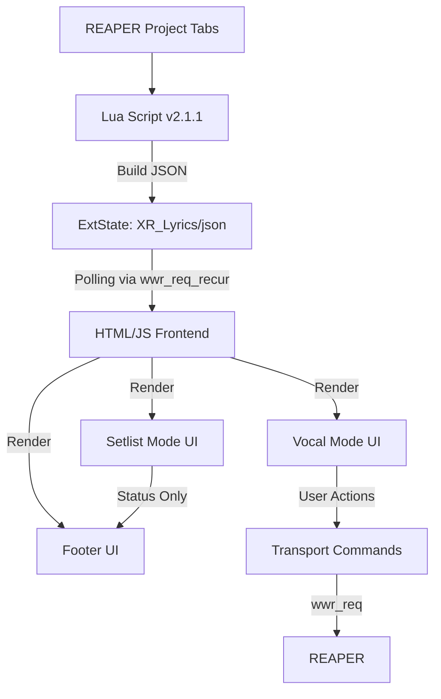

# MOTJAW StageMaster — Developer Notes
Version: 2.1.1  
Audience: Developers, integrators, contributors

This document describes the internal architecture, data flow, and development considerations for MOTJAW StageMaster v2.1.1.

---
# Requirement
Reaper [https://www.reaper.fm/download.php]
sws Extention [https://sws-extension.org/index.php]

# 🏗 Architecture Overview

MOTJAW StageMaster consists of two main components:

1. **Lua Backend (REAPER)**
   - Runs continuously in the background.
   - Extracts metadata from the active project tab.
   - Builds a JSON payload containing:
     - Lyrics
     - Regions + colors
     - EndTrack marker
     - Next project name
     - Full setlist (all project tabs)
   - Writes JSON to REAPER ExtState.

2. **HTML/JS Frontend**
   - Loaded inside a WebView (via ReaImGui or wwr).
   - Polls ExtState via `wwr_req_recur`.
   - Renders:
     - Vocal Mode (lyrics)
     - Setlist Mode (song list)
     - Footer (progress bar, playhead, timers)
   - Sends transport commands (Vocal Mode only).

---

# 🔄 Data Flow Diagram (Mermaid)

# References
## JSON Schema (v2.1)
{
  "next_project": "Song B",
  "end_time": 182.5,
  "entry": [
    { "pos_start": 0.0, "pos_end": 4.0, "text": "Line 1" }
  ],
  "regions": [
    { "start": 0.0, "end": 16.0, "color": "#FF0000", "name": "Verse" }
  ],
  "setlist": [
    "Song A",
    "Song B",
    "Song C"
  ]
}
